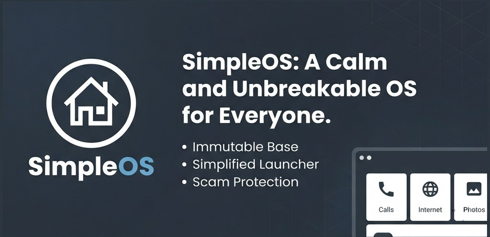

# SimpleOS

A free, open-source Linux computer for people who want things to be simple.

It is built for older adults and for the family members who help them. The idea is straightforward. A computer should be easy to read, hard to break, and calm enough to use without worrying about clicking the wrong thing.

> The image, desktop, launcher, reminders, and caregiver tools all work. There is a full automated test suite, an image build, and a website. See the [changelog](CHANGELOG.md) for release history.

- Source and downloads: <https://github.com/MT25MB/SimpleOS>
- Website and caregiver guide: <https://mt25mb.github.io/SimpleOS/>



[Brand assets and how to save new versions](docs/assets/README.md) · [Plain-English caregiver guide](docs/caregiver-guide.md) · [USB install walkthrough](docs/usb-install.md) · [Hardware compatibility and setup checklist](docs/hardware-compatibility.md) · [Updates and recovery](docs/updates-and-recovery.md) · [Hardware support and power behaviour](docs/hardware-support.md) · [Changelog](CHANGELOG.md)

New here? Start with [CONTRIBUTING.md](CONTRIBUTING.md). For community expectations see the [Code of Conduct](CODE_OF_CONDUCT.md), and for private vulnerability reports see [SECURITY.md](SECURITY.md).

---

## Why we made it

Most desktops are built for people who already know their way around a computer. That leaves a lot of people behind.

The text is small. There are too many choices. A wrong click can cause real damage. Pop-ups and fake warnings are everywhere, and they are aimed squarely at people who are least likely to spot them.

SimpleOS takes those problems seriously. The system cannot be damaged by a stray click. The browser is locked down. The home screen shows six big buttons and nothing else.

### What that looks like day to day

- **Readable.** Text starts at 18 pixels and goes bigger with one click. The cursor is large. Windows open full screen.
- **Few choices.** Six tiles on one screen, each with one obvious job.
- **Safe from scams.** Firefox only allows HTTPS, blocks notification and location pop-ups, and ships with uBlock Origin locked in. Other extensions cannot be added.
- **Nothing to break.** The system files are read-only. Updates arrive in one piece, and the last working version is always kept. The image is linted as a bootable container before it is published.
- **Reliable first start.** Account setup retries a few times if Wi-Fi is patchy, then always lets the desktop start. It never waits forever.
- **No keyboard escapes.** Every desktop shortcut that could open a terminal, close a window or move things around is disabled in the kiosk session.
- **Calm permission prompts.** Firefox uses validated enterprise policies so video calls work without repeated camera or microphone questions.
- **No admin account.** The everyday user is called `senior` and has no sudo or wheel access.
- **Free.** No subscription, no account, no tracking, no telemetry. MIT licensed.
- **Easy to listen to.** Read Aloud speaks the screen and reminders using a local voice, and stops with one press or Escape.
- **Easy to talk to.** Hold to Speak understands five simple commands locally with Vosk. No audio ever leaves the computer.
- **Family one tap.** Up to four family contact cards open a private video room in the locked-down Firefox.
- **Calm when idle.** An optional photo frame shows local family photos and a big clock, and closes instantly when touched.
- **System health and safe recovery.** Caregiver Settings shows a plain-English health summary and can restart the launcher, check for updates, or roll back the last OS update with one confirmed press. Rollback is limited to one narrow system action; the everyday user never gets sudo.

### What is in the repository

- `os-image/Containerfile` builds an immutable bootc image from uBlue's Fedora Atomic base. It includes labwc, greetd, Orca, CUPS, Flatpak, PipeWire, Firefox, Loupe and RustDesk. The clock defaults to UTC.
- `system-configs/` holds the desktop, greetd autologin, Firefox policies, and the first-boot service. greetd signs straight into the `senior` account.
- `simpleos-shell/` is the React and Electron launcher. It has six tiles, daily reminders saved to `~/.config/simpleos`, and caregiver settings behind a PIN.
- `scripts/` has the ISO builder and a QEMU test script.
- `.github/workflows/` builds and publishes the image to GHCR, publishes this site, and runs the tests.

---

## Repository layout

```
.
├── docs/                       static GitHub Pages site
├── os-image/Containerfile      immutable image definition
├── system-configs/
│   ├── labwc/                  desktop behaviour and environment
│   ├── greetd/                 autologin as "senior"
│   ├── firefox/                browser policies
│   └── systemd/                first-boot setup
├── simpleos-shell/
│   ├── electron/               main process and preload bridge
│   └── src/                    React UI, hooks, and tests
├── scripts/
│   ├── build-iso.sh            image to bootable ISO
│   └── test-vm.sh              build and boot in QEMU/KVM
└── .github/workflows/
    ├── build-image.yml         test, build, publish to GHCR
    └── deploy-pages.yml        publish docs/ to GitHub Pages
```

---

## Build and test for $0

Everything here uses free software and free tiers.

### What you need

- Podman and sudo, for the image and ISO builds. The ISO builder needs Podman because it mounts host container storage.
- QEMU with KVM, or VirtualBox, if you want to boot it locally.
- Node.js and npm, only if you are working on the launcher.
- A GitHub account, for the free build and registry.

### Build the ISO

```sh
# Pulls the image built by CI, then writes an ISO into output/
bash scripts/build-iso.sh

# Or build the image on this machine first
bash scripts/build-iso.sh --build
```

Every published release also has a ready-made installer on the [releases page](https://github.com/MT25MB/SimpleOS/releases), so building one yourself is optional. It is attached as numbered ISO parts with a checksum because the full installer is larger than GitHub's per-file limit; [the USB walkthrough](docs/usb-install.md) shows how to join them. A release ISO is built from that release's exact image, while the installed computer still tracks `latest` for future updates.

You can change `IMAGE_TAG`, `TARGET_IMAGE_REF`, `ROOTFS_TYPE`, `OUTPUT_DIR`, `BUILDER_IMAGE`, and `CONTAINER_ENGINE`. Run `bash scripts/build-iso.sh --help` for the full list. `TARGET_IMAGE_REF` controls which image the installed system updates from; it defaults to the image used to build the ISO. `ROOTFS_TYPE` selects the installed system's root filesystem (`ext4` by default).

To flash a USB stick, use `--flash`. The script checks that the drive is removable and unmounted, then asks you to type the device name before it writes anything.

```sh
SIMPLEOS_CONFIRM_FLASH=YES bash scripts/build-iso.sh --flash /dev/sdb
```

A warning first. Flashing erases everything on that drive. Check the device name twice.

### Automated headless boot test

`scripts/test-boot.sh` builds the image from source, creates a bootable qcow2 disk, and boots it in QEMU with no window and a hard timeout. It captures serial output and QEMU interrupt/CPU-reset logs, and passes only when the guest reaches `SIMPLEOS_BOOT_SUCCESS` — which means greetd, labwc and the launcher all started. Run it on a Linux host with Podman, QEMU and OVMF:

```sh
bash scripts/test-boot.sh --reset
```

CI runs the same check in `.github/workflows/boot-test.yml` on Ubuntu 24.04 and uploads the logs.

### Run the tests and build the launcher

From the repository root, one command checks everything:

```sh
bash scripts/test-all.sh
```

It runs the full test suite, type-checks and builds the launcher, checks shell script syntax, and verifies that no build artifacts or disk images are staged. CI runs the suite and build on every push.

To work on just the launcher:

```sh
cd simpleos-shell
npm ci
npm run test
npm run build
```

### Continuous integration

`.github/workflows/build-image.yml` runs on every push to `main`, every Monday morning, and whenever you start it by hand. It builds `os-image/Containerfile`, runs the shell tests and build, then pushes `ghcr.io/<owner>/simpleos` with a `latest` tag, a short commit SHA, and a weekly tag. It uses `GITHUB_TOKEN` with package write access. Pull requests build without publishing.

---

## Testing in a virtual machine

The image needs UEFI. Give the VM at least 4 GB of memory, 2 CPUs, and 20 GB of disk. On the first start, greetd signs in as `senior` and the setup service creates the account, adds Flathub, and installs Firefox, Loupe, and RustDesk. Give it a few minutes before the launcher appears. For the full minimum and recommended hardware list, and a plain-English setup checklist, see [hardware compatibility](docs/hardware-compatibility.md).

### The quick way, with QEMU on Linux

Install the tools:

```sh
# Debian / Ubuntu
sudo apt install qemu-kvm qemu-system-gui qemu-utils ovmf
# Fedora
sudo dnf install @virtualization qemu-img ovmf
```

Then let the script do the work:

```sh
bash scripts/test-vm.sh              # build the image and boot the disk
bash scripts/test-vm.sh --reset      # start over and test first boot again
bash scripts/test-vm.sh --iso        # build an ISO and boot the installer
```

The disk lives at `build-vm/simpleos-test.qcow2`. Keep it between runs to hold on to reminders and settings. Use `--reset` when you want a clean first boot.

### Do it yourself with QEMU

Find the ISO with `find output -name '*.iso'`, then:

```sh
qemu-img create -f qcow2 simpleos-test.qcow2 20G

qemu-system-x86_64 \
  -m 4096 -smp 2 -accel kvm \
  -bios /usr/share/OVMF/OVMF_CODE.fd \
  -cdrom output/bootiso/install.iso \
  -drive file=simpleos-test.qcow2,format=qcow2 \
  -vga virtio -display gtk
```

The OVMF path changes between distributions. Use `find /usr/share -name 'OVMF_CODE.fd'` to locate it. Without KVM, drop `-accel kvm`. It will be slower, but it works.

### VirtualBox

1. Create a machine called SimpleOS, Linux, Fedora 64-bit.
2. Give it 4096 MB of memory, 2 CPUs, and a 20 GB dynamic disk.
3. Turn on EFI in System settings and I/O APIC in Processor settings.
4. Attach the ISO to the optical drive.
5. Start it, install SimpleOS, then remove the ISO when asked.

### If something looks wrong

| What you see | What to check |
| --- | --- |
| Black screen | UEFI must be on. Legacy BIOS will not boot this image. |
| No network | Set the VM network to NAT. |
| First boot looks stuck | Flatpak apps are still downloading. Wait, or restart if needed. |
| Text is too small | Caregiver Settings, then Text size, then Large or Extra Large. |

---

## Caregiver setup, short version

1. Set the caregiver PIN when asked. Use at least four numbers and write them down. There is no reset yet.
2. Open Caregiver Settings and choose Large or Extra Large text.
3. Add a reminder with a time, then try Mark Done and Start a new day.
4. Open Ask for Help and check that RustDesk starts with the blue sharing banner.
5. Restart and check that the PIN and reminders are still there.

## The full fifteen-minute walkthrough

- [ ] **0–2 min**. Check that the home screen shows six large tiles and that the text is comfortable.
- [ ] **2–4 min**. Open Caregiver Settings. Set a PIN of at least four numbers and save it somewhere safe.
- [ ] **4–5 min**. Set Text size to Large or Extra Large. Check that labels and buttons still fit.
- [ ] **5–7 min**. Open Daily Reminders. Add two reminders with times, mark one done, then press Start a new day.
- [ ] **7–9 min**. Open Web & Email. Check that Firefox opens, uBlock Origin is there, and sites use HTTPS. No notification or location prompts should appear.
- [ ] **9–10 min**. Open Photo Album and look at a photo.
- [ ] **10–12 min**. Open Ask for Help. Check the blue sharing banner, then make sure RustDesk opens and sharing can be stopped inside it.
- [ ] **12–13 min**. In Caregiver Settings, open Wi-Fi & Network, Printers, and Open RustDesk. Each should open and close cleanly.
- [ ] **13–14 min**. Choose Check for updates. You should see a short sentence such as "Your system is up to date. Version 41."
- [ ] **14–15 min**. Restart. Check that the PIN still unlocks Settings and that both reminders are still listed.

---

## Contributing

Contributions are welcome. Keep them focused and documented, and keep the accessibility and safety ideas in mind. This is still a young project, so the shape will change.

## Licence

SimpleOS is released under the [MIT License](LICENSE).
